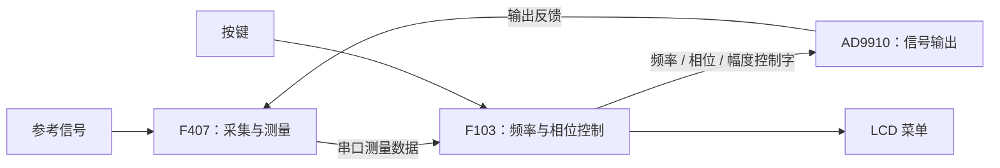

# STM32 李萨如图形显示控制装置

**STM32F407 采集测量 · STM32F103 闭环控制 · AD9910 信号输出**

本项目通过测量外部参考信号和 DDS 输出反馈，调整 AD9910 的频率、相位与幅度档位，使两路信号按对角线、圆或无穷形状所需的关系输出，供示波器 XY 模式显示李萨如图形。项目面向全国大学生电子设计竞赛 F 题，仓库收录双 MCU 嵌入式源码。

[文档导航](docs/README.md) · [核心算法在哪里](#核心算法在哪里) · [建议阅读顺序](#建议阅读顺序) · [目录说明](#目录说明) · [编译工程](#编译工程) · [验证与边界](#验证与边界)

## 先了解两块 MCU 分别做什么

| 硬件 | 负责的事情 | 主程序 |
|---|---|---|
| STM32F407ZGTx | 同步采集参考/反馈两路信号，计算频率、相位和峰峰值，再通过串口发送结果 | [MY/main.c](firmware/F407_Project/MY/main.c) |
| STM32F103ZE | 接收测量值，运行频率/相位控制，处理按键、LCD 和诊断输出 | [USER/main.c](firmware/F103_Project/USER/main.c) |
| AD9910 | 接收 F103 写入的控制字，产生信号输出 | [AD9910V1.C](firmware/F103_Project/HARDWARE/ad9910/AD9910V1.C) |



外部模拟调理和输出电路未在图中展开，接线与待确认内容见 [硬件说明](docs/hardware.md)。本仓库不收录独立视觉子系统。

## 核心算法在哪里

**只看核心逻辑，先读 `measurement.c` 和 `manual_control.c`，再读 `AD9910V1.C`。** 下表链接直接定位到源码函数；文件内补充了中文导航与关键步骤注释。

### 采集与测量：F407

主文件：[measurement.c](firmware/F407_Project/MY/measurement.c)。它回答“输入信号的频率、相位和幅度是多少”。

| 想看什么 | 直接看这个函数 | 实际做法 |
|---|---|---|
| ADC 与 DMA 怎么配置 | [Measurement_Init()](firmware/F407_Project/MY/measurement.c#L305) | TIM2 触发两路 ADC 同步转换，DMA 搬运采样 |
| 如何取得一段可分析的数据 | [Measurement_TakeReadyFrame()](firmware/F407_Project/MY/measurement.c#L410) | 从 DMA 缓冲复制后半段 8000 对采样 |
| 频率与峰峰值怎么算 | [Measurement_AnalyzeChannel()](firmware/F407_Project/MY/measurement.c#L53) | 均值穿越 + 滞回 + Q16 插值；最大值减最小值 |
| 相位怎么计算 | [Measurement_CalculateIqPhase()](firmware/F407_Project/MY/measurement.c#L172) | 去均值后进行单频 IQ 相关，用 atan2 求相位 |
| 反馈为二倍频时怎么比较相位 | [Measurement_CalculateRelativePhase()](firmware/F407_Project/MY/measurement.c#L234) | 判断 1F/2F，组合两路相位并修正二倍频偏置 |
| 上面几步怎样串起来 | [Measurement_Analyze()](firmware/F407_Project/MY/measurement.c#L438) | 汇总两路测量、削顶判定及诊断信息 |

配置入口：[MY/app_config.h](firmware/F407_Project/MY/app_config.h)，含每通道 800 kSa/s、窗口长度、有效范围和协议常量。这些是软件配置，不是实测精度指标。

### 频率与相位控制：F103

主文件：[manual_control.c](firmware/F103_Project/APP/manual_control.c)。它回答“测量结果到手后，下一步怎样调整 DDS”。

| 想看什么 | 直接看这个函数 | 实际做法 |
|---|---|---|
| 控制算法总入口 | [ManualControl_Update()](firmware/F103_Project/APP/manual_control.c#L1051) | 更新目标和反馈，选择当前控制阶段 |
| 反馈值怎么滤波 | [Control_UpdateFeedbackFilter()](firmware/F103_Project/APP/manual_control.c#L341) | 帧去重、离群确认、3 点中值与 IIR |
| 频率相差较大时怎么追踪 | [Control_UpdateAcquire()](firmware/F103_Project/APP/manual_control.c#L591) | 将频差换算为 FTW 的有界调整量 |
| 怎样从捕获进入相位环 | [Control_UpdateFine()](firmware/F103_Project/APP/manual_control.c#L648) | 确认相位/谐波/频差条件；此函数不直接改 FTW |
| 怎么做相位闭环 | [Control_UpdateDpll()](firmware/F103_Project/APP/manual_control.c#L675) | 初始相位对齐、相位 PI、限幅与异常重捕获 |
| 如何从相位变化估计残余频差 | [Control_UpdatePhaseSlope()](firmware/F103_Project/APP/manual_control.c#L494) | 展开相位并结合测量时间戳计算斜率 |
| 如何细化平均输出频率 | [Control_ApplyDpllOutput()](firmware/F103_Project/APP/manual_control.c#L237) | 通过分数累加在相邻整数 FTW 之间选择 |

参数入口：[USER/app_config.h](firmware/F103_Project/USER/app_config.h)，含 PI 系数、相位死区、锁定判据、修正限幅和 ASF 幅度档位。公式与单位解释见 [算法说明](docs/algorithms.md)。

### DDS 驱动：F103 → AD9910

主文件：[AD9910V1.C](firmware/F103_Project/HARDWARE/ad9910/AD9910V1.C)。三个控制字分别是：**FTW 控频率、POW 控相位、ASF 控幅度**。

| 想看什么 | 直接看这个函数 |
|---|---|
| 频率换算成 FTW | [AD9910_FtwFromMilliHz()](firmware/F103_Project/HARDWARE/ad9910/AD9910V1.C#L272) |
| 相位换算成 POW | [AD9910_PowFromMilliDegrees()](firmware/F103_Project/HARDWARE/ad9910/AD9910V1.C#L296) |
| 把 FTW / POW / ASF 写入 DDS | [AD9910_ProfileWriteRaw()](firmware/F103_Project/HARDWARE/ad9910/AD9910V1.C#L311) |

当前使用 GPIO 模拟串行时序。LCD 使用的硬件 SPI2 是另一条接口。

## 数据怎么在代码之间流动

```text
F407 / MY/main.c
  └─ Measurement_TakeReadyFrame → Measurement_Analyze
       └─ Protocol_SendMeasurement：打包并发送测量值
                          │ USART1，921600 baud
                          ▼
F103 / USER/main.c
  └─ SignalCapture_Service → SignalCapture_TakeSnapshot
       └─ ManualControl_Update：控制阶段选择与算法更新
            └─ AD9910_ProfileWriteRaw：更新 DDS 输出
```

| 其他模块 | 源码入口 | 用途 |
|---|---|---|
| 测量帧发送 | [protocol.c](firmware/F407_Project/MY/protocol.c) | 固定 48 字节、小端数据、CRC16、DMA 发送 |
| 测量帧接收 | [signal_capture.c](firmware/F103_Project/HARDWARE/CAPTURE/signal_capture.c) | 帧解析、校验、快照队列与过期判断 |
| 串口底层 | [usart.c](firmware/F103_Project/SYSTEM/usart/usart.c) | F103 USART1 接收 DMA 环形缓冲 |
| 菜单与界面 | [menu_v2.c](firmware/F103_Project/APP/menu_v2.c) | 形状/幅度选择、模式切换、分片刷新 |
| 按键与旁路继电器 | [board.c](firmware/F103_Project/HARDWARE/BOARD/board.c) | 按键消抖、PD2 旁路控制 |
| 运行诊断 | [debug_uart.c](firmware/F103_Project/SYSTEM/debug_uart/debug_uart.c) | USART2 输出 CSV，观察丢帧、削顶和锁定状态 |

通信的具体字段、字节序和校验范围见 [通信协议](docs/communication_protocol.md)。

## 建议阅读顺序

1. **看整体流程**：两个 `main.c`，了解采样、通信、控制分别在哪里调用。
2. **看测量算法**：`measurement.c`，从 `Measurement_Analyze()` 向下看。
3. **看控制算法**：`manual_control.c`，从 `ManualControl_Update()` 看三个控制阶段。
4. **看硬件输出**：`AD9910V1.C`，重点看控制字换算与 `AD9910_ProfileWriteRaw()`。
5. **按需展开**：协议、菜单、板级与诊断；芯片库可以留到查外设 API 时再读。

## 目录说明

```text
firmware/
├── F407_Project/                 # 采集端
│   ├── MY/
│   │   ├── main.c               # 主循环
│   │   ├── measurement.c        # ★ 采样、频率/相位测量
│   │   ├── protocol.c           # 测量结果发送
│   │   └── app_config.h         # 采样及协议参数
│   ├── Project/STM32F407.uvprojx # Keil 工程
│   ├── Drive/                   # LED、延时支持
│   └── STM32/                   # CMSIS、启动文件、ST 标准库
├── F103_Project/                # 控制端
│   ├── USER/main.c              # 初始化与任务调度
│   ├── USER/app_config.h        # ★ 控制参数及幅度档位
│   ├── APP/manual_control.c     # ★ 频率、相位控制算法
│   ├── APP/menu_v2.c            # 菜单与运行界面
│   ├── HARDWARE/ad9910/          # ★ DDS 控制字与底层驱动
│   ├── HARDWARE/CAPTURE/         # 测量帧解析
│   ├── HARDWARE/BOARD/           # 按键、LED、旁路继电器
│   ├── SYSTEM/                  # 串口、诊断、延时支持
│   ├── CMSIS/                   # 内核、启动文件、ST 标准库
│   └── USER/VirtualCOMPort.uvprojx # Keil 工程（沿用原文件名）
└── Tools/                       # 原有主机模型与静态回归脚本
```

`★` 为优先阅读的核心文件。工程内部结构保留，便于使用原 Keil 工程编译；库文件较多，可先按上面的导航查看应用代码。

## 编译工程

使用 **Keil MDK + ARMCC 5 + ST 标准外设库**；CMSIS 和标准库源码已随仓库保留。

| 工程 | 点击打开 | Target |
|---|---|---|
| F407 | [STM32F407.uvprojx](firmware/F407_Project/Project/STM32F407.uvprojx) | `STM32F407` |
| F103 | [VirtualCOMPort.uvprojx](firmware/F103_Project/USER/VirtualCOMPort.uvprojx) | `AD9910_Fanke_Programmable_Controller` |

打开工程后执行 **Rebuild all target files**。输出位于 F407 的 `Project/Objects/` 和 F103 的 `OBJ/`，均由 Git 忽略。本机验证使用 ARMCC 5.05 update 1，工程记录的原版本为 5.06；版本差异和完整日志见 [构建验证](docs/test_results.md)。

## 验证与边界

- 两套工程已全量重建：**0 错误、0 警告**；两个 HEX 校验通过，6 项原有主机回归通过。主机脚本验证的是模型或静态约束。
- 支持手动选择对角线、圆、无穷及 ASF 幅度档；自动模式仍是占位接口。
- 峰峰值目前为 ADC 计数；菜单 1–4V 是历史标签，不能视作最终输出电压已经标定。
- 当前没有 RMS、DAC/VCA810 幅值闭环实现，也没有全频段性能达标结论。ADC 削顶、1 kHz 边界及 ≥75 kHz 稳定性仍需实物复测。

更多资料：[功能核验](docs/feature_audit.md) · [硬件与引脚](docs/hardware.md) · [架构与调度](docs/architecture.md) · [第三方代码说明](THIRD_PARTY_NOTICES.md)

<details>
<summary>整理与审计记录</summary>

原始资料保持原位。本仓库只收录嵌入式双 MCU 工程；源码注释修订和原基线差异可查阅 [交付报告](docs/delivery_report.md)、[原文件清单](docs/file_manifest.csv) 和 [逐文件索引](docs/source_index.md)。

</details>
